<div align="center">

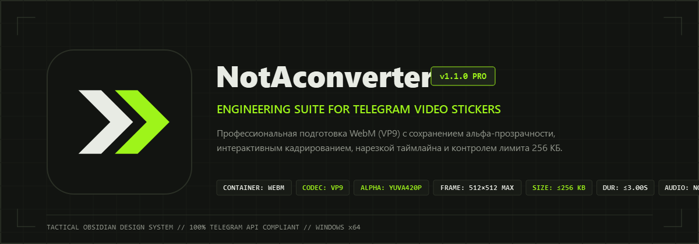

# NotAconverter

**Десктопная инженерная студия для подготовки видеостикеров Telegram.**  
*Любое видео, GIF или фото → ультрачёткий WebM (VP9) со 100% соблюдением спецификации.*

[](https://github.com/notsons-git/notaconverter/releases)
[](https://github.com/notsons-git/notaconverter/releases)
[](https://ffmpeg.org)
[](LICENSE)

<br/>

<a href="https://github.com/notsons-git/notaconverter/releases/latest">
  
</a>
&nbsp;
<a href="https://github.com/notsons-git/notaconverter/releases">
  
</a>

</div>

---

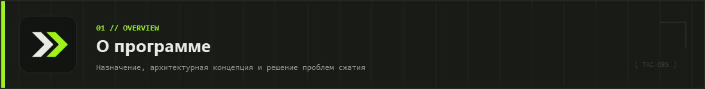

## О программе

Telegram предъявляет строгие детерминированные требования к загружаемым видеостикерам через официального бота `@Stickers`: контейнер **WebM**, кодек **VP9**, полное **отсутствие аудиодорожки**, жесткий лимит веса **до 256 КБ**, длительность **до 3.0 секунд** и обязательная фиксация одной из сторон ровно в **512 пикселей**.

Большинство онлайн-конвертеров и любительских скриптов приводят к регулярным отказам бота:
- Размытие интерполяции и потеря микроконтраста при сжатии.
- Потеря альфа-канала (прозрачности) при перекодировании GIF и PNG.
- Превышение порога 256 КБ из-за неконтролируемого битрейта.
- Необходимость вручную обрезать видео в сторонних тяжелых NLE-редакторах.

**NotAconverter** объединяет полный цикл производства стикеров в единый быстрый конвейер:
- Принимает любые форматы: видео (**MP4**, **MOV**, **MKV**, **WebM**), анимации (**GIF**) и графику (**PNG**, **JPG**, **WebP**).
- Предоставляет встроенный интерактивный видоискатель кадрирования с сеткой правила третей и фиксацией соотношения `1:1`.
- Позволяет с миллисекундной точностью обрезать нужный фрагмент на таймлайне и подогнать длительность кнопкой `FIT [ 3.0s ]`.
- Аппаратно сохраняет альфа-прозрачность (`yuva420p`) и использует адаптивный двухпроходный алгоритм VP9, гарантирующий попадание в лимит 256 КБ с первого раза.
- Построен на базе дизайн-системы **«Tactical Obsidian»** — строгий утилитарный кибер-минимализм без визуального шума и лишних задержек.

---


## Интерфейс и скриншоты

<div align="center">

### 1. Главный экран — управление очередью и пакетный экспорт
<p><em>Сайдбар очереди файлов с бейджами форматов, инлайн-переименованием кликом, выбором папки сохранения и индикатором статуса.</em></p>

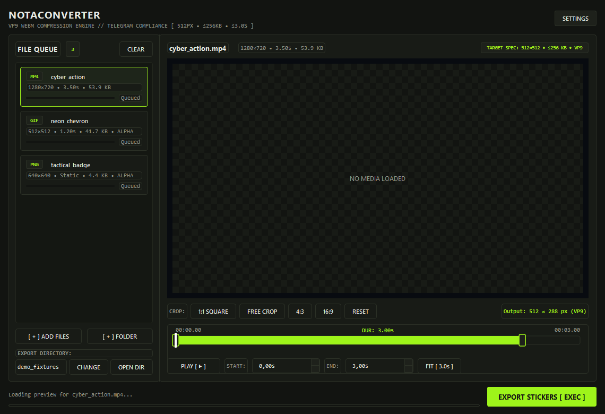

<br/>

### 2. Интерактивный видоискатель кадрирования
<p><em>Точное позиционирование области кадра с сеткой правила третей, перемещаемыми маркерами и пресетами пропорций (1:1, 4:3, 16:9, Free).</em></p>

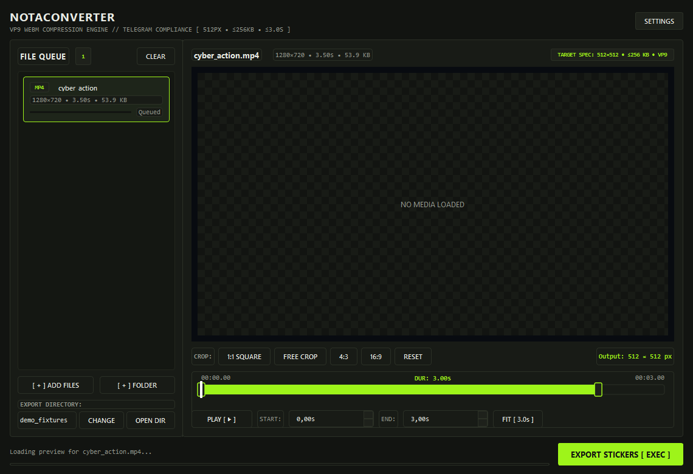

<br/>

### 3. Интерактивный таймлайн и нарезка видео
<p><em>Наглядная временная шкала, управление начальной и конечной точками, скраббинг без фризов через кадровый кеш и горячая клавиша Space для Play/Pause.</em></p>

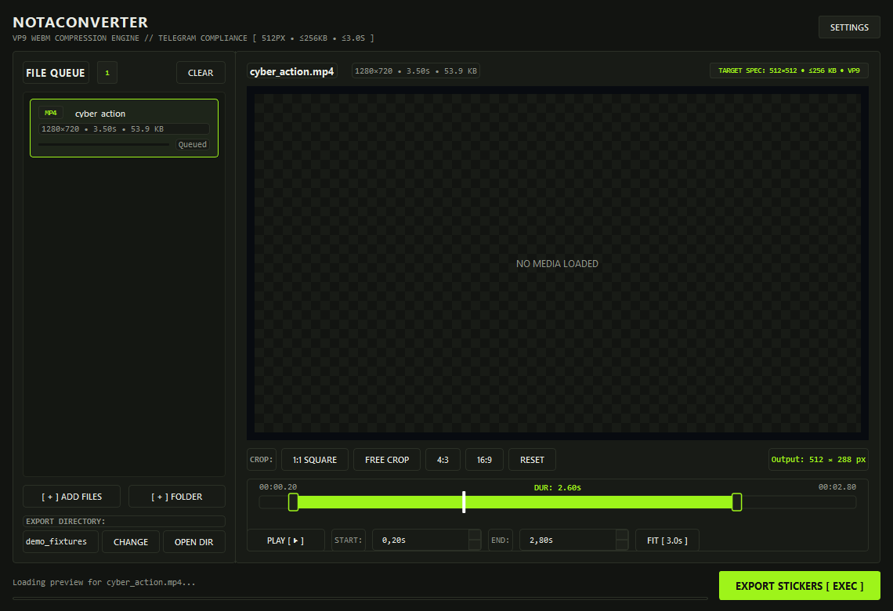

<br/>

### 4. Окно настроек с защитой от случайного скролла
<p><em>Тонкая регулировка качества CRF, битрейта, децимации FPS, потоков кодирования и звукового уведомления с умным вводом громкости.</em></p>

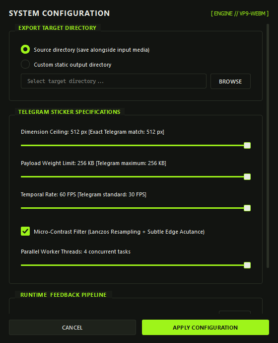

<br/>

### 5. Завершённый пакетный экспорт
<p><em>Индикация успешной конвертации всех задач очереди с автоматической нумерацией дубликатов и тактильным звуковым сигналом.</em></p>

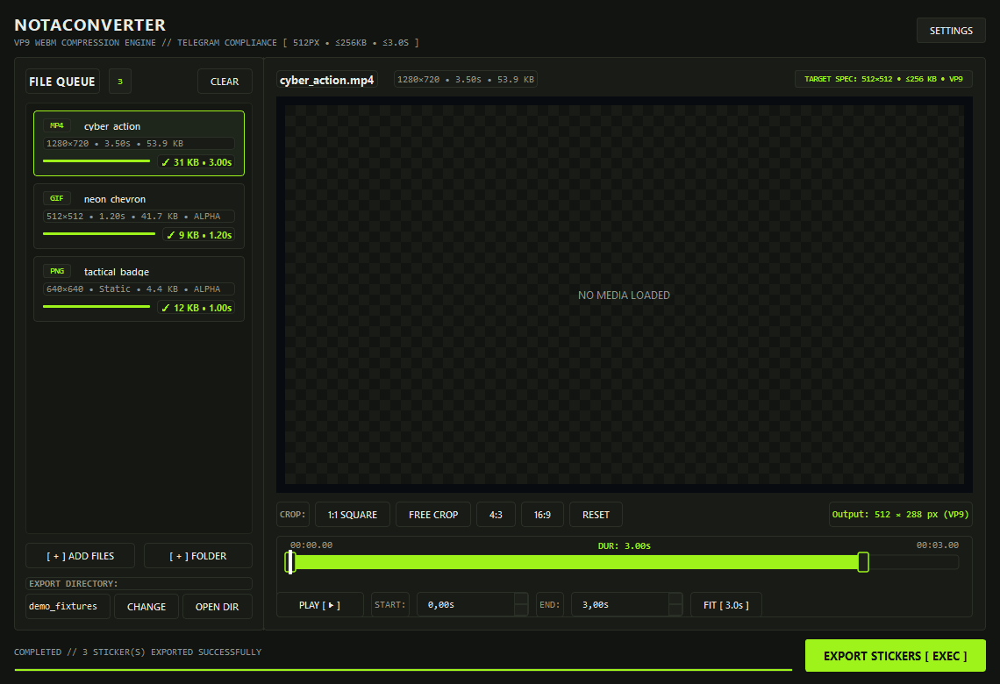

</div>

---

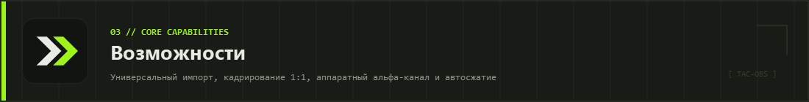

## Возможности

- **Универсальный медиа-импорт**:
  - Видеофайлы: `.mp4`, `.mov`, `.mkv`, `.webm`.
  - Анимации: `.gif` (включая многокадровые с прозрачностью).
  - Статические изображения: `.png`, `.jpg`, `.jpeg`, `.webp`.
  - Добавление через кнопки диалогов или перетаскиванием **Drag & Drop** (файлы и папки целиком).
- **Интерактивное визуальное кадрирование (`InteractiveCropWidget`)**:
  - Быстрые пресеты пропорций: `1:1 Square (Telegram)`, `Free Crop`, `4:3`, `16:9` и сброс.
  - Расчёт геометрических координат относительно оригинального разрешения исходника с округлением до четных пикселей.
  - Затемнённая маска нерабочей зоны и координатная сетка правила третей.
- **Интерактивный таймлайн и монтаж (`TimelineRangeSlider`)**:
  - Управление точками входа и выхода с точностью до сотых долей секунды.
  - Кнопка автоподгонки `FIT [ 3.0s ]` для мгновенного сжатия диапазона под норматив Telegram.
  - Изолированное управление воспроизведением по клавише <kbd>Space</kbd> (пробел никогда не нажимает кнопки в фокусе).
- **Мгновенный предпросмотр без задержек (`FrameCache`)**:
  - Асинхронное фоновое демультиплексирование кадров в оперативную память (RAM).
  - Плавный скраббинг и воспроизведение на стабильной частоте 30 FPS без повторных вызовов подпроцессов FFmpeg.
- **Сохранение альфа-прозрачности**:
  - Полное сохранение масок прозрачности из GIF и PNG с использованием цветового пространства `yuva420p` и VP9 Profile 0/1.
- **Адаптивный контроль размера до 256 КБ**:
  - Двухуровневый контроль: кодирование с коэффициентом постоянного качества CRF (18–42) и автоматический двухпроходный битрейт-кламп при риске превышения лимита.
- **Инлайн-переименование и дедупликация**:
  - Редактирование имени выходного стикера в списке файлов кликом по названию (без необходимости ввода расширения).
  - Автоматическая нумерация `имя (1).webm`, `имя (2).webm` при повторном экспорте без потери оригинала.
- **Процедурное звуковое сопровождение (`sound.py`)**:
  - Встроенный синтезатор 16-bit PCM WAV (мягкий двухтональный аккорд D5+A5, 0.38 с) без внешних аудиофайлов.
  - Звук играет строго один раз по окончании всей очереди.
  - Поле громкости со свободной поддержкой форматов (`99`, `99%`, `.9`, `0.5`).
- **Защита ползунков от колеса мыши (`NoWheelSlider`)**:
  - Прокрутка мыши над слайдерами игнорируется, обеспечивая плавный скролл диалога настроек без случайного сброса параметров.

---

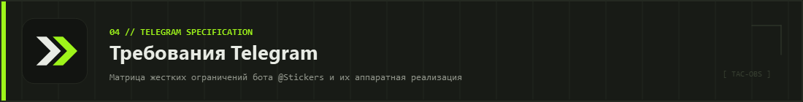

## Требования Telegram к видеостикерам

NotAconverter аппаратно калиброван под официальную спецификацию бота `@Stickers`:

| Параметр | Требование Telegram API | Реализация в NotAconverter |
| :--- | :--- | :--- |
| **Формат контейнера** | Строго `WebM` | `.webm` с потоковыми метаданными |
| **Видеокодек** | Строго `VP9` (`libvpx-vp9`) | Профиль 0 / Профиль 1 (с сохранением альфа-канала `yuva420p`) |
| **Аудиодорожка** | Строго запрещена | Флаг `-an` (полное удаление аудиопотока) |
| **Геометрия кадра** | Одна сторона строго 512 px, вторая $\le 512\text{ px}$ | Автоматический масштабировщик с чётными сторонами |
| **Предел веса файла** | Строго $\le 256\text{ КБ}$ (262 144 байт) | Двухпроходный битрейт-кламп при риске переполнения |
| **Длительность** | Строго $\le 3.00\text{ секунд}$ | Обрезка по таймлайну с миллисекундной точностью, кнопка `FIT [ 3.0s ]` |
| **Частота кадров** | До 30 FPS | Настраиваемый дециматор частоты кадров (10 – 30 FPS) |
| **Зацикливание** | Рекомендовано бесконечное | Автоматическая нормализация ключевых кадров (`gop-size`) |

---

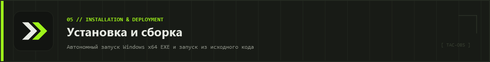

## Установка

### Готовая сборка для Windows (EXE)

Для запуска программы не требуется устанавливать Python или сторонние библиотеки:

1. Откройте [**GitHub Releases**](https://github.com/notsons-git/notaconverter/releases/latest).
2. Скачайте автономный файл **`NotAconverter-1.1.1.exe`**.
3. Запустите программу и приступайте к конвертации.

> *Примечание:* Для работы транскодирования в системе должен быть доступен `ffmpeg` (программа автоматически находит системный FFmpeg из переменной `PATH` либо из локального каталога приложения).

---

## Запуск из исходного кода

Для запуска студии из исходников потребуется **Python 3.11+** и установленный **FFmpeg**:

```bash
# 1. Клонирование репозитория
git clone https://github.com/notsons-git/notaconverter.git
cd notaconverter

# 2. Создание и активация виртуального окружения
python -m venv venv
venv\Scripts\activate

# 3. Установка зависимостей
pip install -r requirements.txt

# 4. Запуск автоматических тестов соответствия Telegram
python test_notaconverter.py

# 5. Запуск приложения
python main.py
```

---

## Сборка Windows (.exe)

Сборка автономного переносимого исполняемого файла выполняется через PyInstaller с оптимизацией веса (исключение неиспользуемых языковых пакетов и тяжелых модулей Qt6):

```bash
python build_optimized_exe.py
```

Готовый файл размером ~30 МБ будет создан в каталоге `dist/NotAconverter-1.1.1.exe`.

---

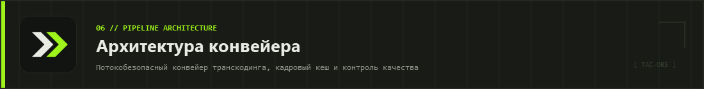

## Архитектура конвейера обработки

Процесс транскодирования полностью изолирован от UI-потока через пул параллельных воркеров `QThreadPool` и неблокирующие подпроцессы `QProcess`.

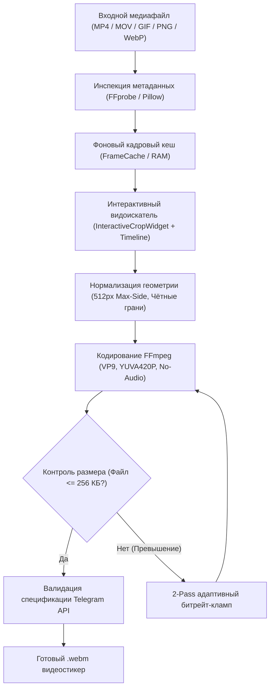

### Структура модулей проекта

```
notaconverter/
├── config.py             # Хранилище настроек и спецификаций Telegram
├── converter.py          # Ядро кодирования FFmpeg, расчет геометрии и битрейта
├── frame_cache.py        # Фоновый кадровый кеш для моментального предпросмотра
├── media_probe.py        # Анализатор медиаданных (разрешение, FPS, альфа-канал)
├── settings_dialog.py    # Окно настроек с защитой NoWheelSlider
├── sound.py              # Процедурный синтезатор 16-bit PCM WAV звука
├── task_queue.py         # Менеджер параллельной очереди задач
├── ui.py                 # Главное окно студии в стиле Tactical Obsidian
└── widgets/
    ├── crop_overlay.py   # Интерактивный видоискатель кадрирования
    ├── file_list_widget.py # Карточки очереди файлов с инлайн-переименованием
    └── timeline_slider.py# Временная шкала с нарезкой и подгонкой FIT [ 3.0s ]
```

---

## Конфиденциальность

- **100% локальная обработка**: Все видео-, аудио- и графические данные обрабатываются исключительно локально на вашем компьютере. Приложение **не отправляет файлы в интернет и не использует облачные сервисы**.
- **Отсутствие телеметрии**: В коде полностью отсутствуют трекеры, аналитика и сбор пользовательских данных.
- **Прозрачное хранение настроек**: Конфигурация сохраняется синхронно в текстовый локальный файл `config.json` в каталоге приложения.

---

## Лицензия

Проект распространяется под свободной лицензией **[MIT License](LICENSE)**. Вы можете свободно использовать, модифицировать и распространять программное обеспечение при условии сохранения уведомления об авторских правах.

---

<div align="center">
<sub>NOTACONVERTER ENGINEERING TEAM // ALL RIGHTS RESERVED // TELEGRAM COMPLIANT</sub>
</div>
