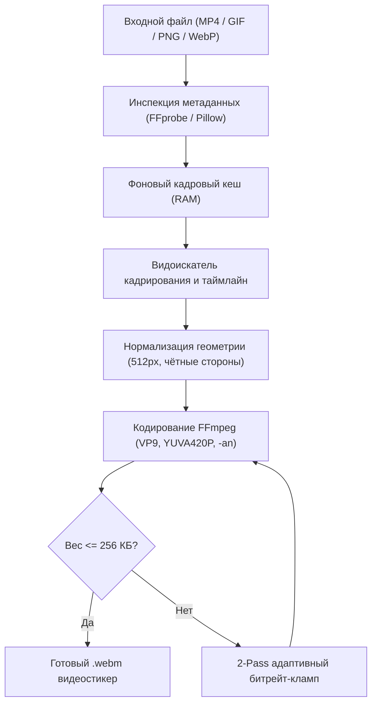

<div align="center">


# NotAconverter

**Десктопная студия для подготовки видеостикеров Telegram.**  
*Любое видео, GIF или фото → готовый WebM (VP9) по спецификации @Stickers.*

[](https://github.com/notsons-git/notaconverter/releases)
[](https://github.com/notsons-git/notaconverter/releases)
[](https://ffmpeg.org)
[](LICENSE)

<br/>

<a href="https://github.com/notsons-git/notaconverter/releases/latest">
  
</a>
&nbsp;
<a href="https://github.com/notsons-git/notaconverter/releases/latest">
  
</a>

</div>

---


## О программе

Официальный бот `@Stickers` принимает видеостикеры только при строгом соблюдении нормативов: контейнер **WebM**, кодек **VP9**, **без звука**, вес **до 256 КБ**, длительность **до 3.0 секунд** и одна из сторон ровно **512 px**.

**NotAconverter** решает это в пару кликов:
- Принимает любые видео, анимации и изображения.
- Быстро кадрирует область (включая квадрат `1:1`) и обрезает таймлайн.
- Сохраняет альфа-канал прозрачности для GIF и PNG.
- Автоматически укладывает файл в лимит 256 КБ через адаптивное двухпроходное сжатие VP9.

---


## Интерфейс

<div align="center">

### 1. Главный экран
<p><em>Очередь файлов, быстрое переименование кликом, выбор папки экспорта и статус обработки.</em></p>


<br/>

### 2. Кадрирование
<p><em>Позиционирование области обрезки, сетка третей и фиксация квадрата 1:1.</em></p>


<br/>

### 3. Интерактивный таймлайн
<p><em>Нарезка диапазона, моментальный предпросмотр без задержек и быстрая подгонка под 3 секунды (FIT 3.0s).</em></p>


<br/>

### 4. Настройки кодирования
<p><em>Регулировка качества CRF, ограничения битрейта, FPS, потоков кодирования и громкости уведомления.</em></p>


<br/>

### 5. Пакетный экспорт
<p><em>Индикация статуса файлов очереди, автонумерация дубликатов и звуковой сигнал по завершении.</em></p>


</div>

---


## Возможности

- **Импорт любого медиа:** Видео (`.mp4`, `.mov`, `.mkv`, `.webm`), анимации (`.gif`), графика (`.png`, `.jpg`, `.jpeg`, `.webp`). Drag & Drop файлов и папок.
- **Интерактивное кадрирование:** Пресеты пропорций (`1:1 Square`, `Free Crop`, `4:3`, `16:9`), сетка третей, автоокругление до чётных пикселей.
- **Монтаж на таймлайне:** Точные границы обрезки, кнопка `FIT 3.0s`, управление воспроизведением по клавише Space.
- **Моментальный предпросмотр:** Кадровый кеш в RAM — скраббинг и переключение без задержек и повторных запусков FFmpeg.
- **Сохранение прозрачности:** Полная поддержка альфа-канала (`yuva420p`, VP9 Profile 0/1).
- **Гарантированный вес ≤ 256 КБ:** Кодирование с постоянным качеством CRF и автоматический двухпроходный кламп битрейта при риске переполнения.
- **Удобная очередь:** Инлайн-переименование карточек по клику, автонумерация повторных файлов (`file (1).webm`), индикаторы прогресса.

---


## Требования Telegram к видеостикерам

| Параметр | Требование Telegram API | В NotAconverter |
| :--- | :--- | :--- |
| **Формат** | `WebM` | `.webm` с потоковыми метаданными |
| **Кодек** | `VP9` (`libvpx-vp9`) | Профиль 0 / Профиль 1 (с прозрачностью `yuva420p`) |
| **Аудио** | Запрещено | Флаг `-an` (полное удаление звука) |
| **Разрешение** | Одна сторона ровно 512 px, вторая ≤ 512 px | Автоматическое масштабирование с чётными сторонами |
| **Вес файла** | ≤ 256 КБ | Автоматический двухпроходный расчет битрейта |
| **Длительность** | ≤ 3.00 с | Нарезка с точностью до сотых секунды, кнопка `FIT 3.0s` |
| **FPS** | До 30 кадров/с | Настраиваемый дециматор частоты кадров |

---


## Установка и запуск

### 1. Установщик для Windows (Рекомендуется)
1. Откройте [**GitHub Releases**](https://github.com/notsons-git/notaconverter/releases/latest).
2. Скачайте **`NotAconverter-Setup-1.2.0.exe`** (всего 21.5 МБ).
3. Запустите инсталлятор — программа быстро установится в профиль пользователя (права администратора не требуются), создаст ярлык на рабочем столе и меню «Пуск».

### 2. Портативная версия (Standalone EXE)
1. Скачайте **`NotAconverter-1.2.0.exe`** (30.2 МБ).
2. Запустите файл напрямую без установки.

### 3. Запуск из исходного кода (Python 3.11+)
```bash
git clone https://github.com/notsons-git/notaconverter.git
cd notaconverter
pip install -r requirements.txt
python main.py
```

### Сборка исполняемого файла
- **Сборка одного EXE:**
  ```bash
  python build_optimized_exe.py
  ```
- **Сборка инсталлятора (Inno Setup):**
  ```bash
  pyinstaller notaconverter_dir.spec --clean -y
  ISCC.exe installer.iss
  ```

---


## Архитектура



---

## Конфиденциальность

- **100% локально:** Все файлы обрабатываются исключительно на вашем ПК. Приложение не использует внешние сервера и не передаёт данные в сеть.
- **Без телеметрии:** Никаких трекеров и скрытой аналитики.
- **Настройки рядом:** Конфигурация хранится в локальном файле `config.json`.

---

## Лицензия

Распространяется под свободной лицензией **[MIT License](LICENSE)**.
